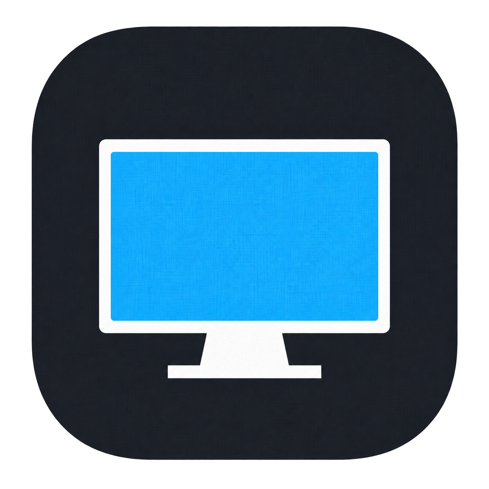
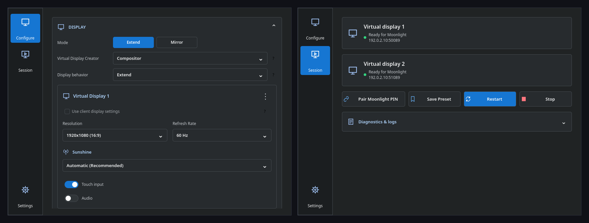

<div align="center">
  
  <h1>Monitorize</h1>
  <p><strong>A virtual display manager for Linux with built-in streaming.</strong></p>
  <p>
    <a href="https://github.com/vinnavannewton/project-monitorize/actions/workflows/desktop.yml"></a>
    <a href="https://github.com/vinnavannewton/project-monitorize/actions/workflows/desktop-release.yml"></a>
    <a href="https://github.com/vinnavannewton/project-monitorize/releases/latest"></a>
    <a href="https://github.com/vinnavannewton/project-monitorize/releases"></a>
  </p>
</div>

https://github.com/user-attachments/assets/14a21a68-011b-43bf-9f26-fc9ea731d80b



Monitorize creates and manages virtual displays on Linux using compositor-native outputs or [monitorize-vkms](https://github.com/vinnavannewton/monitorize-vkms). Use virtual displays on their own, or stream them to another device through built-in Sunshine integration.

For streaming, connect with [Moonlight](https://moonlight-stream.org/) on Android, Linux, Windows, macOS, iOS, or another supported device.

## Installation prompt for AI agents

Copy this prompt into an AI assistant of your choice for help installing and configuring Monitorize on your Linux host.

<details>
<summary>Show installation prompt</summary>

```text
Help me install and configure Project Monitorize on my Linux host.

Before taking any action on my host, read both READMEs and every page in
each repository's GitHub wiki, where available. If a repository has no wiki,
use its README and in-repo documentation for setup.

Project Monitorize
https://github.com/vinnavannewton/project-monitorize
https://github.com/vinnavannewton/project-monitorize/wiki

Monitorize VKMS
https://github.com/vinnavannewton/monitorize-vkms

1. Use what I have already told you. If my goal is unclear, ask whether I want
   a tablet or laptop as a second display, both as two additional displays
   alongside my existing monitor, or remote desktop access from the login
   screen. For remote desktop, find out whether the host has a usable physical
   display at sign-in or is headless. Identify the host's distro and release,
   running kernel, desktop environment, and Wayland or X11 session. For boot
   access, check the display manager separately. Inspect the host if you can
   and ask only for the missing details.

2. Check the current desktop support table and open the installation guide
   linked for my distro.
   https://github.com/vinnavannewton/project-monitorize#supported-desktops
   https://github.com/vinnavannewton/project-monitorize#installation

   Prefer compositor-native displays for a supported desktop extension setup.
   Use Monitorize VKMS where native creation is unavailable and VKMS is
   supported, or when I need login-screen hosting. Compositor-native capture
   can request screen-sharing permission. If I want to avoid recurring
   prompts, check whether my setup supports VKMS with direct capture. Help me
   enable Passwordless Display Creation if I want VKMS displays without
   recurring password prompts. Complete any first-run input, firewall, and
   capture authorization needed for the chosen setup.

3. If VKMS is needed, check Secure Boot and follow the current VKMS install
   instructions for my distro, including matching kernel development files.
   Verify the installed module with monitorize-vkms verify.
   https://github.com/vinnavannewton/monitorize-vkms#prerequisites

   Recommend disabling Secure Boot in BIOS/UEFI as the simpler VKMS setup
   path. Explain that this removes Secure Boot protection. If I choose it,
   guide me through my machine's firmware settings and verify after reboot.
   If I prefer to keep Secure Boot enabled, read and follow the current
   project wiki guide for signing-key enrollment.
   https://github.com/vinnavannewton/project-monitorize/wiki/Enroll-a-Secure-Boot-Key

4. For an extra screen, configure one Extend display. For a tablet and
   laptop together, configure two Extend displays and pair each Moonlight
   client with its own Monitorize listener.

   For login-screen access, install Monitorize VKMS and the matching
   remote-login components. Check display-manager support for the requested
   setup and select Monitorize Auto or KMS capture. Enable boot hosting with
   monitorize boot enable. In the GUI, this is Also start at boot (login
   screen) under Start Monitorize after login in Settings > General.
   Leave Create virtual display at login off when a usable physical display
   is attached, including when I use Extend or Virtual displays only after
   signing in. On a supported headless host, enable it with
   monitorize boot login-virtual-on. Explain any display-manager limitation
   before changing boot settings.

   For remote login or a headless display setup, recommend SSH as a recovery
   option. With my approval, help me enable the SSH server on the streaming
   host at boot and verify that I can connect from another device over my
   trusted LAN or VPN before relying on Moonlight. Explain that SSH gives me
   terminal access if a distro update, Monitorize crash, or configuration
   problem leaves the graphical session or stream unavailable. Show me how
   to use monitorize status, locate monitorize.json with monitorize config
   path, edit the settings, and apply them with monitorize reload. Show me
   how to use monitorize stop and monitorize start if hosting needs a restart.

5. Summarize the setup you chose for my goal. If you have terminal access to
   my host, use the Monitorize CLI and JSON to configure it for me. Follow the
   Terminal and SSH section for the right launcher. Run monitorize config path
   to generate or locate monitorize.json from my current settings. Edit the
   requested settings in that file, apply them with monitorize reload, and
   check the result. Use the setup and boot commands for system permissions
   and boot policy. Use monitorize start and monitorize status to check that
   the requested session is ready.

   Confirm with me before making privileged changes or rebooting. If a step
   needs me to approve a prompt, change firmware settings, or run a command,
   give me the exact step and wait for my result. Verify it and resume.
   If you have no host access, give me the CLI commands and guide me using
   the results I share.
   https://github.com/vinnavannewton/project-monitorize#terminal-and-ssh

6. Help me pair in Moonlight and check video and input on each requested
   display. For boot hosting, test the login screen and reconnect to the
   desktop after signing in. Ask me to confirm tests that require my
   Moonlight device. Finish by telling me how to connect and what you verified.
```

</details>

## Features

- Create and manage up to two virtual displays.

- Support compositor-native virtual displays and monitorize-vkms.

- Stream virtual displays or mirror an existing monitor through Sunshine.

- Configure streaming encoders, codecs, audio, touch, and stylus options via the integrated sunshine.

- Keeps Monitorize's Sunshine instances separate from your existing Sunshine setup.

## Supported desktops

This table shows whether each desktop environment supports via compositor-native virtual displays, [monitorize-vkms](https://github.com/vinnavannewton/monitorize-vkms), or both.

| Desktop Environment                    | Compositor | monitorize-vkms |
| -------------------------------------- |:----------:|:---------------:|
| KDE Plasma 6.7+                        | ✅          | ✅               |
| GNOME 50+                              | ✅          | ✅               |
| Hyprland (Aquamarine 0.15.1+ for VKMS) | ✅          | ✅               |
| Niri                                   | ❌          | ✅               |
| Cinnamon X11                           | ❌          | ✅               |
| COSMIC                                 | ❌          | ❌               |

## Installation

- [Fedora](https://github.com/vinnavannewton/project-monitorize/wiki/Fedora-installation)
- [Arch Linux](https://github.com/vinnavannewton/project-monitorize/wiki/Arch-installation)
- [Ubuntu](https://github.com/vinnavannewton/project-monitorize/wiki/Ubuntu-installation)
- [openSUSE Tumbleweed](https://github.com/vinnavannewton/project-monitorize/wiki/openSUSE-Tumbleweed-installation)
- [NixOS / Nix](https://github.com/vinnavannewton/project-monitorize/wiki/Nix-installation)

## Contributing

Want to contribute? See the [Contributing guide](https://github.com/vinnavannewton/project-monitorize/wiki/Contributing).

## Usage

For DEs with no compositor-native virtual display support, use via VKMS by installing [monitorize-vkms](https://github.com/vinnavannewton/monitorize-vkms).

Tip: If the stream is black or crashes, try changing the stream from auto to other options in monitorize based on what your hardware supports.

### Terminal and SSH

Native packages use `monitorize`. Source installs provide the same launcher
at `linux/venv/bin/monitorize`. An existing source checkout can also run
`venv/bin/python -m monitorize` from its `linux` directory. For Flatpak, use
`flatpak run com.vinnavan.Monitorize` with the same arguments.

```sh
monitorize setup --status
monitorize setup --input --firewall
"${EDITOR:-nano}" "$(monitorize config path)"
monitorize reload
monitorize start
monitorize status
```

For firewalld, use `setup --status` to review the network scope and
`setup --firewall --zone ZONE` to select a zone explicitly. Run administrator
actions from an SSH connection with a terminal, such as one opened with
`ssh -t`. Flatpak administrator actions require the matching Monitorize CLI
and setup helpers on the host. Source users can stage the matching host
helpers with `python3 scripts/stage-remote-login.py` from the checkout root
and follow the printed installation steps. An input grant can require a fresh
desktop login. `monitorize setup --status` reports that separately from
the saved grant.

Request a PIN in Moonlight, then run `monitorize pair` and enter it at the
prompt. `monitorize stop` stops hosting. `reload` validates edits and reports
changes that need a restart. Use `reload --restart` when you want to apply
those changes during a connected stream. Per-display encoder, codec, and
GPU selections use `streaming_customized`. Set it to `true` to select
values explicitly. Boot policy uses the authorized `boot` commands.

Desktop hosting uses the logged-in graphical session. To host before login on
a supported system, use `monitorize boot status` and `monitorize boot enable`
with the installed remote-login components.

## Star History

<a href="https://www.star-history.com/?repos=vinnavannewton%2FProjectMonitorize&type=date&legend=top-left">
 <picture>
   <source media="(prefers-color-scheme: dark)" srcset="https://api.star-history.com/chart?repos=vinnavannewton/ProjectMonitorize&type=date&theme=dark&legend=top-left&sealed_token=UrJIpYgjHe4fJj10B7GKSJo0AdhR5bGEFiNv9cpP4iJQEhNXknPXAq5aX7g6bk2y7UAMoa3xfVqKyRWSANVZobe2uVlMjvYXbCaeOmO5w6tdzEvCjnFejmzXxjtW2mIf4Yny6uOhs2jXSxC01ZMh5Q_Dd6dRD2NniWjkaltRE1SzVWfwyOP0rZwE5oCI" />
   <source media="(prefers-color-scheme: light)" srcset="https://api.star-history.com/chart?repos=vinnavannewton/ProjectMonitorize&type=date&legend=top-left&sealed_token=UrJIpYgjHe4fJj10B7GKSJo0AdhR5bGEFiNv9cpP4iJQEhNXknPXAq5aX7g6bk2y7UAMoa3xfVqKyRWSANVZobe2uVlMjvYXbCaeOmO5w6tdzEvCjnFejmzXxjtW2mIf4Yny6uOhs2jXSxC01ZMh5Q_Dd6dRD2NniWjkaltRE1SzVWfwyOP0rZwE5oCI" />
   
 </picture>
</a>
